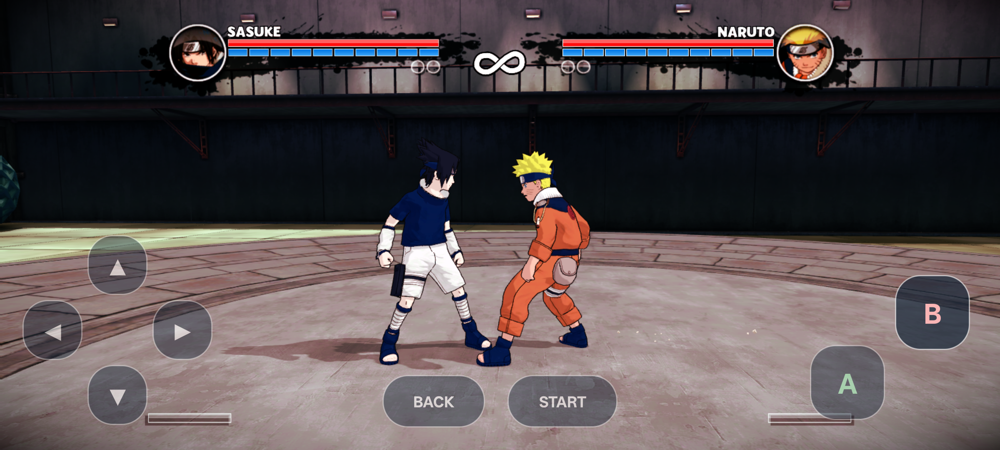
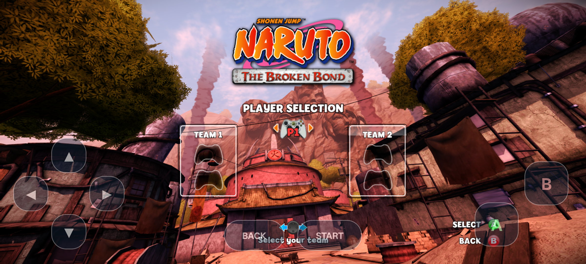

# Naruto: The Broken Bond — Android port

An unofficial, experimental **native ARM64 Android port** of the Xbox 360 game, built on [jorjbarbosa's Broken Bond recompilation](https://github.com/jorjbarbosa/broken-bond-recomp) and the [ReXGlue SDK](https://github.com/rexglue/rexglue-sdk).

**Current checkpoint: the original intro, menus, player selection, and a training fight render on a physical phone, with basic touch input and sound. The latest user report is approximately 1 FPS. Performance is the main blocker; this is not a smooth or finished release.**



*Actual OPPO A58 capture, development APK 0.4.0. A rendered frame documents progress, not playable frame rates.*

## How it works

The upstream project translates the original PowerPC executable into C++ ahead of time. This Android work compiles that code for ARM64, adapts the runtime, and brings the native renderer to Android Vulkan. Original game files supply the content.

This runs translated original game code. It does not recover Ubisoft's original source code. It does not use Wine, Winlator, or Box64, and the visible menus and fight are not newly recreated scenes.

```text
Your Xbox 360 executable → ReXGlue code generation → ARM64 game library
Your assets + translated shaders → Android runtime + native Vulkan renderer
Android touch overlay → SDK controller input → original game
```

## Progress

| Area | Android checkpoint |
| --- | --- |
| Original CPU code | 188 generated C++ units; 32,479 original routines translated |
| Runtime | ARM64 fibers, kernel services, filesystem, audio, original entry-point execution |
| Graphics | Vulkan, BC texture fallbacks, bounded descriptors, clip-plane fallback |
| Intro and menus | Original intro, menu, and player selection observed |
| Gameplay | Original Sasuke vs Naruto training/fight scene reached and rendered |
| Touch | Start, Back, D-pad, A, B; simultaneous presses and brief taps |
| Startup | Persistent Vulkan driver pipeline cache; long black transitions remain possible |
| Orientation | Landscape game activity and corrected surface rotation |
| Performance | **About 1 FPS reported on the tested phone; optimization pending** |
| Full game | Campaign completion, save/load, networking, and broad device support unverified |



*Original player selection with the current touch overlay. Virtual analog sticks and a complete button layout are still needed.*

## Documentation

- [Detailed port progress and next steps](docs/android-port-progress.md)
- [Android developer build notes and setup gaps](docs/android-build.md)
- [Validation results and measurement limits](docs/android-validation.md)
- [Screenshot provenance](docs/screenshots/README.md)
- [Preserved upstream README](UPSTREAM_README.md) and [upstream documentation](docs/README.md)

Tested on an **OPPO A58 (CPH2577), ARM64, Android 15, Mali-G52 MC2, approximately 6 GB RAM**. Other phones are unvalidated. This checkpoint publishes source, SDK patches, diagnostics, and screenshots. There is no ready-to-play APK release, and a fresh-checkout Android build has not yet been verified.

## Game files

Bring your own legally obtained, supported copy. Original executables, disc images, assets, generated original-code translations, and game-derived shader caches are excluded. The development app uses extracted assets staged separately from the APK; a complete consumer game importer is not implemented.

Supported `default.xex`: title `55530825`, media `09FFE047`, version `0.0.0.3`, SHA-256:

```text
8f70e79443e36b38e44b6a105dad51fb8909fb615d982753cabaac9b15f0d576
```

## Credits and license

- [jorjbarbosa/broken-bond-recomp](https://github.com/jorjbarbosa/broken-bond-recomp): original recompilation, game integration, renderer, and desktop work. This Android branch starts from `37b72e657c24022df8057f0cb1b718b81830c77a` and preserves upstream history.
- [ReXGlue](https://github.com/rexglue/rexglue-sdk): PowerPC recompilation and runtime services.
- [Rise of a Ninja recomp](https://github.com/jorjbarbosa/naruto-rise-recomp), [Plume](https://github.com/renderbag/plume), SDL, libucontext, and the dependencies credited upstream.
- Naruto and the original game belong to their respective rights holders. This project is unofficial and is not endorsed by Ubisoft or the Naruto rights holders.

Source remains under [GPL-3.0](LICENSE); dependency licenses also apply. That source license does not grant rights to game content shown in screenshots. AI tools assisted development and documentation; observed results and limitations are recorded in the validation notes.
